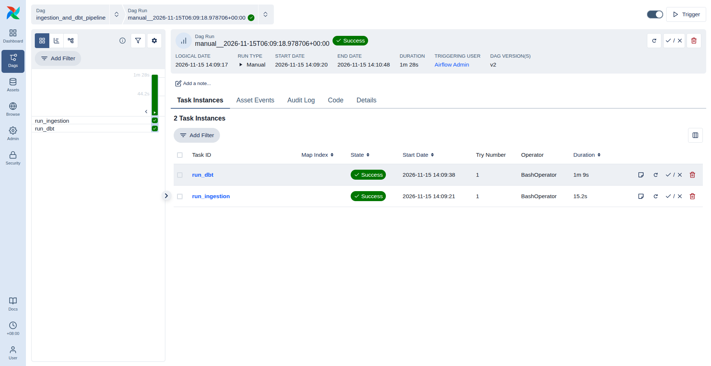
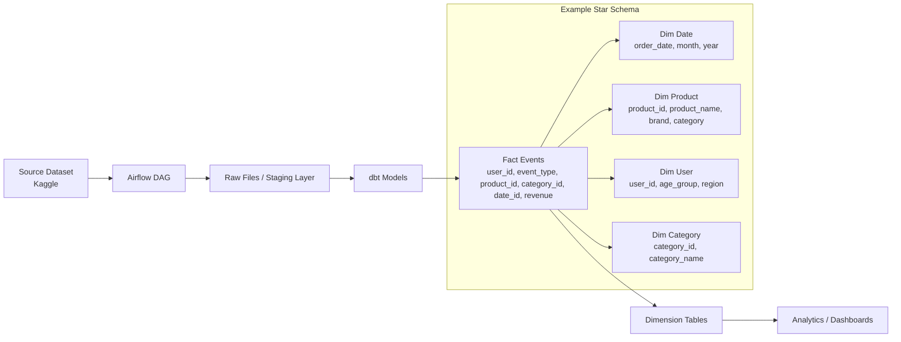

# E-commerce Behavior Data Pipeline



This project builds a data pipeline for department store e-commerce behavior data. It downloads a dataset, loads it into a warehouse layer, and transforms it with dbt so it can be used for reporting and analytics.

## Overview

The pipeline is designed to:

- ingest raw e-commerce event data from a Kaggle dataset
- automate ingestion and transformation tasks with Apache Airflow
- stage raw data in a database-friendly structure
- model the data with dbt for analytics-ready tables
- support downstream reporting and business analysis

## Technology Stack

- Python
- Apache Airflow
- DuckDB
- PostgreSQL
- dbt
- Docker / Docker Compose
- KaggleHub
- SQL

## Project Structure

- `import_data.py` - downloads the source dataset from Kaggle
- `dags/` - Airflow DAG definitions for scheduling and orchestration
- `data_pipeline_dbt/` - dbt project for transformations and models
- `raw_files/` - raw CSV files used by the ingestion layer
- `config/` - pipeline configuration files
- `logs/` - runtime logs
- `plugins/` - custom Airflow plugins
- `docker-compose.yml` and `airflow-compose.yml` - container setup for local orchestration

## Pipeline Flow

1. A dataset is downloaded using KaggleHub.
2. The ingestion script loads the raw CSV into a raw database schema.
3. Airflow orchestrates the ingestion and dbt execution process.
4. dbt builds transformed models for analysis.
5. The prepared data is ready for analytics, dashboards, and reporting.

## Data Workflow

The project follows a simple analytical pipeline pattern:

- Source data: public e-commerce behavioral dataset
- Raw layer: CSV and database staging tables
- Transformation layer: dbt models
- Output: analytics tables and reporting-ready data

## Dataset

Source dataset:
https://www.kaggle.com/datasets/mkechinov/ecommerce-behavior-data-from-multi-category-store

## Architecture and Star Schema

The project follows a typical modern data stack pattern: raw ingestion, staging, transformation, and analytics-ready tables.



This analytical model is organized around a central fact table that captures customer behavior events and several dimensions that provide context such as time, product, category, and user attributes.

## Setup

This project is intended to run in a local containerized environment using Docker and Airflow. Once the services are started, the Airflow DAG can be triggered to run the ingestion and transformation flow.

### Local setup steps

1. Clone the repository.
2. Start the containers:
   ```bash
   docker-compose up -d
   ```
3. Open the Airflow UI and trigger the ingestion and dbt DAG.
4. Ensure the dataset is downloaded or placed in the expected raw data location.
5. Run the dbt project from the `data_pipeline_dbt` directory when needed:
   ```bash
   cd data_pipeline_dbt
   dbt run --profiles-dir .
   ```

## Notes

This repository is focused on data engineering for e-commerce behavior analytics. It is suitable for learning, prototyping, and expanding into more advanced reporting use cases.
